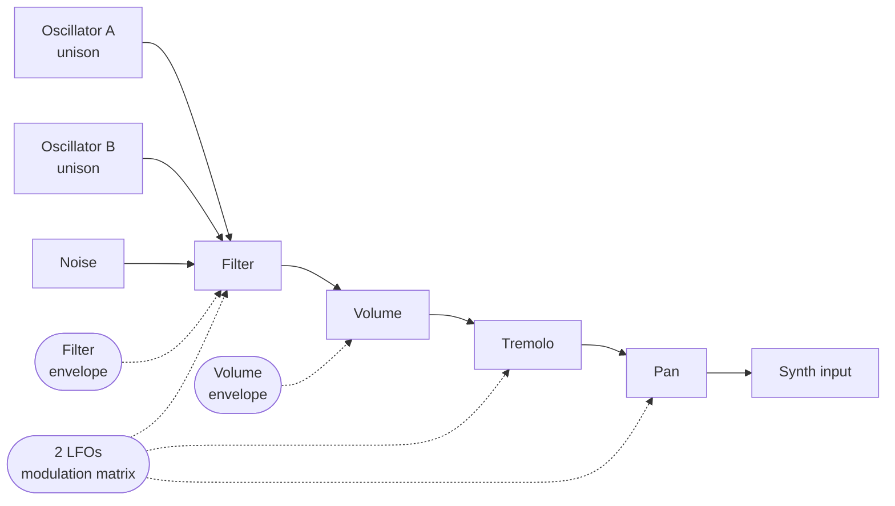
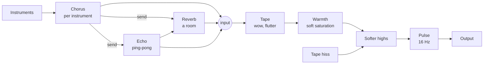
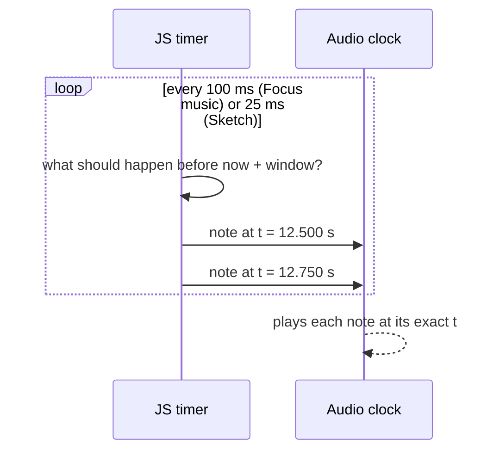

# 1. Sound and time

*[Version française](../fr/1-son-et-temps.md)*

All of Drifton's sound is made live by the browser, with **Web Audio**: no audio files, no
samples (except the reverb, which is computed too). This page follows the sound from the
keyboard to the speakers, and explains how notes are played right on time.

## The studio: a graph of nodes

In Web Audio you connect nodes like cables in a studio. An oscillator produces a signal, a
filter colours it, a gain sets its volume, and the last node is the output
(`ctx.destination`, the speakers).

Web Audio nodes are **native**: the browser computes them in C++, on a thread reserved for
audio. JavaScript doesn't compute samples; it builds the graph and schedules changes.
That's why a whole synth fits in a phone without crackling.

## One synth note (`synth/`)

Each note played creates a **voice** (`synth/voice.js`), thrown away once the note has
died out.

- **Unison** (`osc.js`): each oscillator is really several copies, very slightly detuned
  (a few hundredths of a semitone) and spread across the stereo field. They slowly drift in
  and out of phase: the thick sound of pads.
- **ADSR envelope** (`envelope.js`): Attack (rise), Decay (fall), Sustain (held level),
  Release (fade after the key is let go). It makes no sound: it moves a setting over time
  (the volume, or how open the filter is).
- **LFO** (`lfo.js`): an oscillator too slow to hear (0.01 to 20 Hz), plugged into a
  setting to move it. Two special shapes: *Drift* glides to a new random value every
  period (nothing the ear can anticipate), *S&H* jumps to it.
- **Modulation matrix** (`params.js`): four slots, "this source → that setting, by this
  much".
- **Polyphony**: 8 voices per synth (14 for Focus music's piano). Beyond that, the oldest
  is cut off gently (`steal`).

A **sound** (patch) is just an object `{ setting: value }` for every setting listed in
`params.js`; the Synth page builds its interface from that list. Starter sounds live in
`patches.js`, edited sounds are kept in the browser (`storage.js`, see
[page 5](5-data-and-privacy.md)).

## The effects (`synth/effects.js`)

Effects are shared by all the instruments of a page, like a mixing desk with its sends:

- **Reverb**: a `ConvolverNode` plays the sound through the "response" of a room. We don't
  record a room: we make a few seconds of stereo noise that dies away and gets darker,
  which is what a real room does.
- **Echo**: two delays sending the sound back and forth (left, right), with a filter in
  the loop that makes each repeat softer, like tape echo.
- **Warmth**: a soft saturation (`tanh`, which rounds off the peaks and adds harmonics)
  then a filter that softens the highs.
- **Pulse**: the volume moves up and down a little, 4 to 16 times a second (amplitude
  modulation). Brain.fm uses 16 Hz for focus.
- **Tape**: the pitch wobbles slowly (*wow*) and trembles quickly (*flutter*) thanks to a
  very short delay whose length moves; plus a hiss, cut when nothing plays.
- **Chorus**: two short delays (13 and 17 ms) modulated in opposite directions, left and
  right. It lives *inside* the instrument, and only exists when its setting is above 0
  (it costs nothing otherwise).

Each sound keeps its own effect settings: chorus amount, and how much it sends to the
reverb and the echo.

After the effects comes the **MasterBus** (`synth.js`): a compressor set very hard that
acts as a limiter (it only touches the peaks, so the output never clips), the master
volume, and an analyser that doesn't change the sound but lets the page draw it
(oscilloscope, visual).

## Playing on time: the scheduler

The trap: JavaScript timers (`setTimeout`, `setInterval`) are imprecise. They can be tens
of milliseconds late, much more when the tab is in the background. Drums played that way
would sound drunk.

The audio clock (`ctx.currentTime`) is exact. And Web Audio lets you schedule a note **in
the future**: `osc.start(t)` starts exactly at time `t`.

Hence the **lookahead scheduler**: a timer wakes up often and schedules everything that
should sound in the coming window. It doesn't matter if it is 20 ms late: the notes are
already locked to the audio clock.

| Tool | Wake-up | Window | Why |
|---|---|---|---|
| Focus music | 100 ms | 1.5 s | nothing interactive to the note: a big margin survives even a background tab |
| Sketch | 25 ms | 150 ms | a launched clip, an added note or a tempo change must be heard almost at once |

## Two instruments without a classic oscillator

- **Plucked string** (`chords/pluck.js`, Karplus-Strong algorithm, 1983): a burst of noise
  put in a loop exactly one period long (sample rate ÷ note frequency). The loop repeats,
  so we hear a pitch; at each pass two neighbouring samples are averaged, which kills the
  highs faster than the lows, like a real string. Each note is computed once (2.5 s) then
  replayed from a cache. Used by Chords and by the Songbook's "Guitar" sound.
- **Synthesized drums** (`sketch/drums.js`): the kick is a sine whose pitch falls very
  fast; the snare a short tone plus a burst of noise; the hi-hat six square waves at
  unrelated pitches (the trick of 80s drum machines), high-passed.

## The iPhone (`audio.js`)

Every page creates its studio with `createAudio()`, which gets around two iOS traps:

1. **The silent switch** mutes web audio. Safari 17+ lets a page declare itself a "player"
   (`navigator.audioSession.type = "playback"`); for older versions we loop a tiny silent
   audio file, which switches the page into playback mode.
2. **Sound only starts after a gesture**, and for Safari a gesture is the *end* of a touch
   (`touchend`, `click`), not its start. So we wake the audio on those events, and every
   time the tab comes back (after a phone call, for instance).
