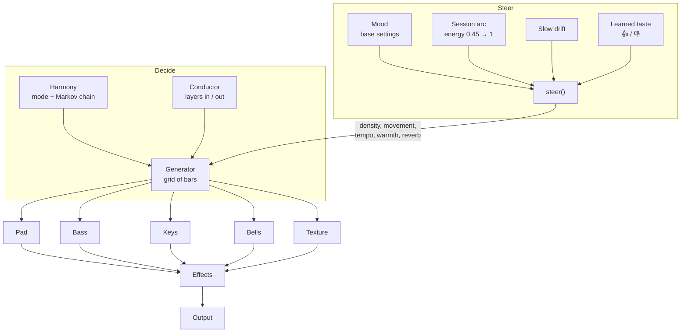
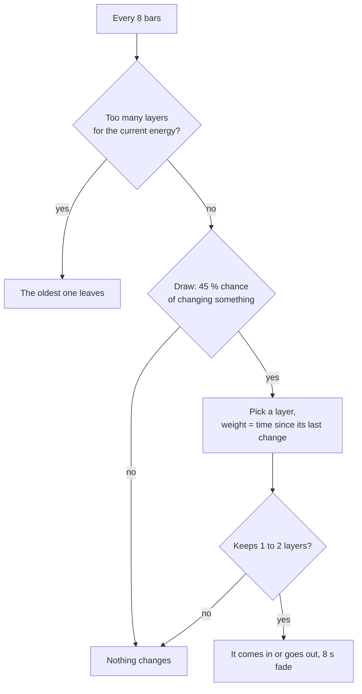
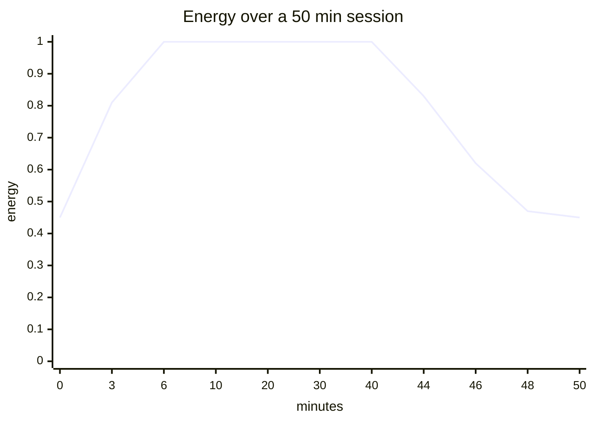
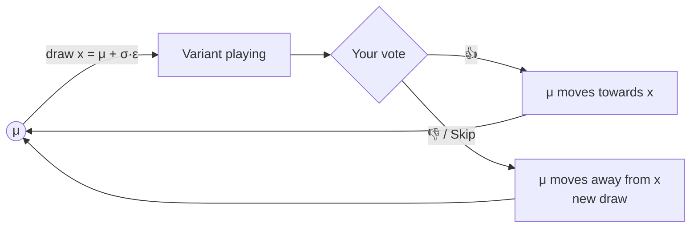

# 2. Focus music

*[Version française](../fr/2-focus-music.md)*

Focus music composes live, endlessly, music made not to draw attention. Nothing is
recorded: **rules** decide at every bar which notes to play. This page explains those
rules, from harmony to learning your taste.

Files: `generator/harmony.js` (harmony), `generator.js` (roles and time), `moods.js`
(moods), `session.js` (arc, drift, breathing filters), `taste.js` (👍 / 👎), `visual.js`
(visual), `main.js` (the page, which wires everything).

## Overview



The page's sliders set a **base**. What actually plays is that base moved a little by the
session arc, the drift and your taste (the `steer()` function of `main.js`, called every
2 seconds). So the sliders never move on their own.

## Harmony (`harmony.js`)

### A mode, and the chords it contains

A **mode** is a 7-note scale. D dorian = D E F G A B C. A chord is built by stacking every
other note of the scale ("thirds"): from D we get D F A C E = Dm7 with a ninth. Every chord
built this way belongs to the mode: **nothing can sound wrong**, which is what background
music needs.

| Mode | Colour | Used by |
|---|---|---|
| ionian (major) | bright | Calm |
| mixolydian | warm major | Flow, Hazy |
| dorian | soft minor, not sad | Deep focus, Drone |
| aeolian (natural minor) | melancholic | Night, Sleep |

The diminished chord (no perfect fifth) is left out: too tense for this music.

Three **chord styles**: `sevenths` (4–5 note chords, lush), `sus` (root, fifth, second and
sixth, no third: neither happy nor sad, Hazy's foggy sound), `drone` (root and fifth, held
for a very long time).

### Choosing the next chord: a Markov chain

The next chord depends only on the current one (that's the definition of a **Markov
chain**). We draw among the other degrees, weighted by how far the root moves:

| Move (in scale degrees) | Weight | Why |
|---|---|---|
| +3 (a fourth) | 3 | the most natural move in tonal music |
| +2, +4, +5 | 2 | moves by a third, soft, very common in ambient |
| +1, +6 | 1 | stepwise moves, rarer |
| back to degree I | +1.5 | coming "home" now and then |

In `drone` style it almost always stays on I, and only leans to IV or V before coming
back.

A chord lasts about `chordSeconds` (12 to 60 s depending on the mood, ±25 % at random),
rounded to 1, 2, 4 or 8 bars: changes always fall at the start of a bar.

### Moving from chord to chord: voice leading

When the chord changes, each pad note goes to the **nearest** note of the new chord; a
note shared by both chords stays put. Changes glide instead of jumping. That's what a
pianist does when chords are well connected.

## The five roles (`generator.js`)

| Role | What it plays |
|---|---|
| Pad | 4 notes of the chord, held, voice-led from chord to chord |
| Bass | the root, low; with movement: on beat 1, sometimes the fifth on the "and" of 3 |
| Keys | little arpeggios on the chord, in eighth notes; busier as movement rises, some bars empty. In Hazy: a **riff** of 5 to 7 notes repeated bar after bar, refitted to each chord, renewed every 16 bars |
| Bells | single notes (see below) |
| Texture | one long note, rarely changing |

### Bells: a random walk

- **When**: the gap between two bells follows an **exponential distribution** (like
  raindrops: no pulse). The average number of bells per second is
  `0.03 + 0.5 × density`.
- **Which note**: a random walk on the scale, in small steps (±1 or ±2 degrees mostly),
  bouncing off the edges. A note outside the chord is often nudged onto its neighbour
  (6 times out of 10): the melody leans on the chord.
- **A motif**: 15 % of the time, the last 3–4 notes are played again. The ear thinks it
  recognises something, without ever hearing an actual tune.

## The conductor: layers come and go

Keys, bells and texture are **optional** layers. Every 8 bars the conductor may bring one
in or out, fading over 8 seconds.



- **The weight** of each layer is the time since its last change: the one that hasn't moved
  for longest is the most likely to change. Each layer gets its turn.
- **Never empty, never crowded**: always at least one optional layer, at most two (only one
  at low energy, or in Sleep).
- **A layer switched off** on the page doesn't count as "playing".
- **At start**: pad and bass alone for 2 bars (time for the reverb to fill), then the
  layers fade in.

## The session arc (`session.js`)

A 15 to 90 minute session has a shape: gentle start, plateau, descent, final fade. It boils
down to one number, the **energy**, between 0.45 and 1.



(Over the last 75 seconds it is the volume that goes down to zero; the energy stays at 0.45.)

- **Rise**: 12 % of the session, between 2 and 5 minutes. Also in endless mode.
- **Descent**: 15 % of the session, between 3 and 8 minutes, just before the fade.
- **Final fade**: 75 s (2 min in Sleep), then a clean stop.
- In **Sleep** the shape is "down": it winds down gently from the first minute to the last.
- Transitions use an S-curve (`x² (3 − 2x)`): no audible corner.

What low energy does: fewer bells (density × `0.35 + 0.65 e`), less rhythm (movement ×
`0.5 + 0.5 e`), a warmer, darker sound, a single optional layer.

## The slow drift

In endless mode, density, movement and brightness wander very slowly around the settings,
so an hour of music is never quite still. Each setting follows an **Ornstein–Uhlenbeck
process** (a random walk pulled back towards its mean):

```
x ← x − x·dt/τ + size·√(2·dt/τ)·N(0, 1)
```

- `τ = 4 min`: the pull takes minutes to bring the setting back.
- `size` is the typical offset once settled: ±6 % density, ±4 % movement, ±0.05
  brightness. Capped at 2.5 sizes.
- `N(0, 1)` comes from the Box–Muller method (two uniform numbers → one normally
  distributed number).

It is small on purpose: you shouldn't notice it, only feel it.

## The breathing filters

Pad and texture go through a soft low-pass filter whose cutoff is pushed by **two very slow
sines**, of 48 s and 29 s, by up to about ¾ of an octave. Their periods don't divide each
other: the breathing never falls back into an exact loop. The session arc darkens this
filter at the start and at the end.

## Learning your taste: 👍 / 👎 / Skip (`taste.js`)

A small **bandit** per mood learns 5 offsets, each between −1 and +1, added to the mood's
settings:

| Setting | At ±1 |
|---|---|
| density | ±15 % bells |
| movement | ±20 % rhythm |
| brightness | brighter / darker |
| tempo | ±8 bpm |
| reverb | ±15 % room |

### The policy

For each mood we keep a mean **μ** (our best guess of what you like, 0 at first = the mood
as designed) and a width **σ** (our uncertainty, 0.35 at first). What plays is a
**variant** drawn around μ: `x = μ + σ·ε`, with `ε ~ N(0, 1)` on each setting. A new
variant on every visit.

### The update

```
μ ← μ + 0.5 · reward · (x − μ)          σ ← max(0.12, 0.9 · σ)
```

| Button | Reward | Effect on μ | Then |
|---|---|---|---|
| 👍 Like | +1 | goes halfway towards the variant | the variant stays |
| 👎 Dislike | −1 | moves away by half the distance | a new variant right away |
| Skip | −0.4 | moves away by a fifth | a new variant, next chord at the next bar |



This is the **REINFORCE** (policy gradient) step for a Gaussian policy: the gradient of
`log N(x; μ, σ)` with respect to μ is `(x − μ) / σ²`. Evolution strategies do the same.
σ shrinks with every vote: the more you've voted, the less it explores far away.

Example, Calm, on tempo: μ = 0, the variant drawn is −0.5 (= −4 bpm). You like it: μ goes
to −0.25 (−2 bpm), and the next variants centre on −2 bpm.

**Limits**: the vote judges everything playing (a chord, a misplaced bell…), not only these
5 settings, so the learning only holds on average over several votes; a 👎 pushes all 5
settings at once; timbres and harmony are not learned.

Everything stays in the browser (key `drifton.focus.taste.v1`), erasable with "Forget my
tastes".

## Moods (`moods.js`)

A mood is just a set of settings: mode, tempo, chord length, density, movement, reverb,
echo, warmth, pulse, tape, chord style. **Auto** picks one from the time of day: Flow in
the morning, Deep focus in the afternoon, Calm in the evening, Night at night, Sleep only
between 1 and 5 am (without a timer: the music doesn't stop by itself).

## Playing a progression

With `?prog=I-V-vi-IV&tonic=0` in the address, the generator replaces its Markov chain with
this loop of chords, at a fixed length. Roman numerals are read by
`progressions/theory.js` (see [page 3](3-chords-and-progressions.md)). A bell falling a
semitone from a chord note (a borrowed chord, like bVII) slides onto it.

## The visual (`visual.js`)

A fake 3D in Canvas 2D: each object has a position (x, y, z), and we divide by z to draw it
(the farther, the smaller and the closer to the centre). The camera drifts slowly forward.

- **Each instrument has its shapes**: pad = circles and planets, bass = bundles of lines,
  texture = turning wireframe volumes, bells and keys = glows.
- **A glow sits at the angle of its note**: C at the top, then clockwise, like a 12-note
  clock face.
- **Trails**: each frame starts from the previous one, slightly enlarged, turned and faded
  (*feedback*).
- **Reacting to the sound**: the analyser gives the energy of lows, mids and highs,
  compared with their recent peak (so it reacts the same to loud or quiet sound).
- **Nothing flashes**: the 16 Hz pulse is deliberately not shown (fast flicker is tiring,
  even potentially harmful). The visual only draws when it is visible.
