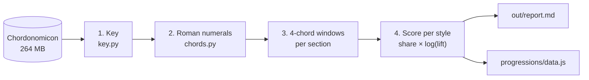
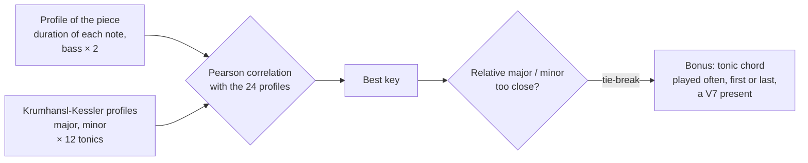

# 3. Chords and progressions

*[Version française](../fr/3-accords-et-progressions.md)*

This page covers everything about chords: the offline analysis of 680,000 songs (Python),
roman numerals, voicings, key detection in a MIDI file, guitar positions and the
arrangement format.

## Roman numerals, the common language

A chord written as a roman numeral is relative to the tonic: `I` is the chord built on the
tonic, `V` on the fifth, and so on. The same progression `I–V–vi–IV` gives C–G–Am–F in C,
or D–A–Bm–G in D. That's what lets us **compare songs** in different keys, and
**transpose** in one gesture.

Drifton writes numerals the chromatic way, like the dataset:

| Writing | Meaning |
|---|---|
| `vi` | lower case = minor chord |
| `bVII` | `b` = a semitone below the major-scale degree (here a whole tone below the tonic) |
| `IVmaj7`, `V7`, `ii7` | the colour (quality) follows the numeral |
| `IV/5` | the IV chord with the key's 5th in the bass |

`progressions/theory.js` reads these numerals (`parseNumeral`, a regular expression),
turns them into a chord in a key (`makeChord`) then into notes (`voiceChord`). Focus music,
Sketch, Progressions, the Songbook and Chords all go through it.

## The Chordonomicon analysis (`tools/progressions/`, Python)

The [Chordonomicon](https://huggingface.co/datasets/ailsntua/Chordonomicon) dataset gives
the chords of ~680,000 songs, without their key. The Python script (standard library only)
finds progressions **typical of a style but rare elsewhere**.



1. **Key**: count the notes heard in the chords and compare with the typical profile of
   each of the 24 keys (see Krumhansl below), plus a bonus for the chord that opens the
   sections and ends the song.
2. **Roman numerals**: each chord becomes a degree above the tonic. Two levels: the
   skeleton (`vi`), which is counted, and the colour (`vi7`), kept to show how the style
   dresses the progression.
3. **Windows**: within each section, repeated chords are merged, then a 4-chord window
   slides along. A window can hide a shorter loop (`i bVII i bVII` → `i bVII`), and all
   rotations of a loop count as one (`I V vi IV` = `vi IV I V`).
4. **Score**: per style, `share of the style's songs using it × log(lift)`, where **lift**
   says how many times more common the loop is in this style than in all songs. It's the
   TF-IDF idea for words in a document: frequent here *and* rare elsewhere.

License CC BY-NC 4.0: free to use with attribution, **no commercial use**.

## Voicings (`progressions/voicing.js`)

A voicing says which notes of the chord the right hand plays, and where.

| Style | What it is |
|---|---|
| close | all notes packed together, each chord as near as possible to the previous one. The default |
| open | the same, every other note raised an octave: wide, airy |
| drop 2 | the close voicing with its 2nd note from the top dropped an octave: the classic jazz spread |
| shell | rootless (the bass plays the root): third and seventh, the notes that say what the chord is, plus tensions |

All of them start from a well-placed close voicing, so the voice leading stays smooth
whatever the style.

## Finding the key and chords of a MIDI file (`progressions/analyze.js`)

"Analyse my MIDI file" turns a MIDI file into a progression, in three steps.

**1. Chords.** Cut the piece per bar (or per beat), weigh the notes sounding in each slice,
and try every chord (12 roots × 11 qualities). The chord's notes count for it, the others
against it, a richer chord must earn its extra note, a root in the bass gets a bonus.

**2. Key: the Krumhansl-Schmuckler algorithm.** In listening experiments, Krumhansl and
Kessler had listeners rate how well each note "fits" after a given key. That gives a
12-value profile for major and one for minor.



C major and A minor share their notes and score almost the same: the chords break the tie.
When the chords themselves are identical the ambiguity remains, and the page says so ("or
maybe A minor").

**3. Loop.** Most songs repeat a few chords: find the group of 2 to 8 chords that covers
most of the piece.

## The Push view (`progressions/push.js`)

Ableton Push's 8×8 grid, in its two layouts:

- **chromatic**: one pad to the right = a semitone, one row up = a fourth. A chord type
  always has the same shape, whatever the key.
- **In Key**: scale notes only. One pad to the right = the next scale note, one row up =
  three scale notes higher (a fourth again). No wrong notes, but a chord borrowed from
  outside the scale can't be played whole.

## Guitar: computed positions (`chords/positions.js`)

For any chord, Chords looks for playable positions along the neck:

- first the **hand-written** shape (`chords/shapes.js`) if there is one, or the one passed
  by the Songbook's link;
- then, for each hand position, the best shape within **4 frets** (always playable), at
  most 4 fingers, at least 3 strings, with every note of the chord except possibly the
  fifth, and the bass note lowest.

Note names are spelled for the chord: E major has a G#, not an Ab.

## The arrangement format (`songbook/arrange.js`)

A chord site's sheet has no rhythm: every chord lasts the same. An arrangement does: it's
how I play the song.

```
Hurt — Johnny Cash                                  ← title — artist
Tempo 92 · Capo 0 · Time 4/4 · Strum: D  D U  U D U  ← settings, any order
Shapes: Am=x02210  C=x32010  Dsus2=xx0230  G=320003  ← my fingerings
[Verse]                                             ← a part
| Am . C . | Dsus2 . . . | Am . C . | Dsus2 . . . |  ← bars: one word per beat
```

- In a bar **each word is a beat**: a chord starts there, `.` holds the chord before. A bar
  with a single chord lasts the whole bar.
- `%` repeats the previous bar, `N.C.` is a silence, `x2` at the end of a line repeats it.
- **Strum**: one stroke per slot, the slots spread over the bar (8 in 4/4 = eighth notes).
  `D` = down, `U` = up, `x` = muted hit, lower case = softer.

On playback (`songbook/strum.js`), each chord is strummed following the pattern: down, from
the low string to the high one; up, the other way; 14 ms between strings; accents on the
beats.

## A sheet pasted from a site (`songbook/sheet.js`)

Two writings are understood: a line of chords **above** the line of lyrics (each chord's
column is kept to place it on the right syllable), or chords **inside** the lyrics
(`[Am]some [C]words`, ChordPro style). A line where every word is a chord is a chord line.
Lyrics stay on the device, never in the repository.
