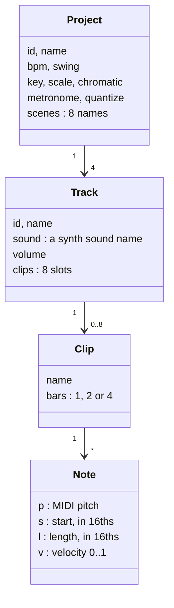
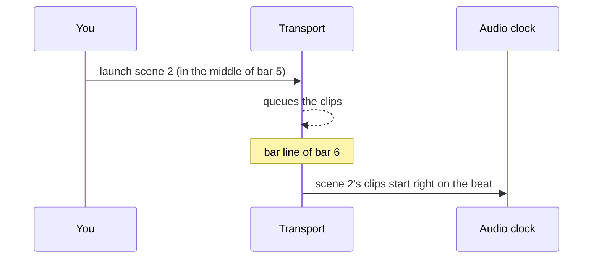
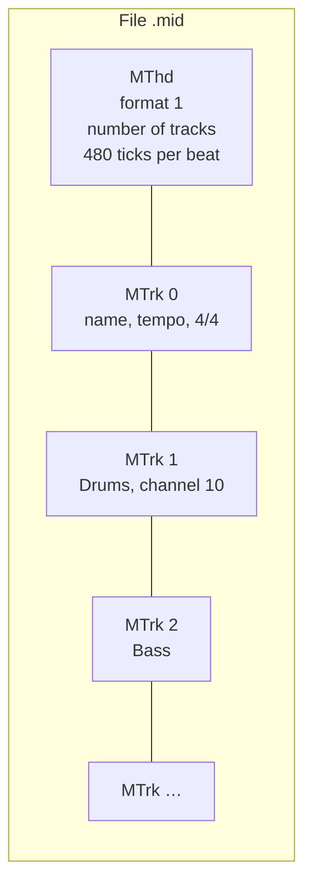
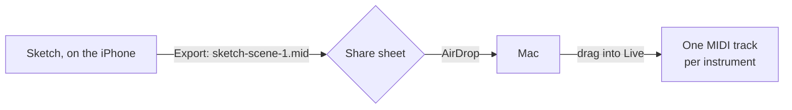

# 4. Sketch and MIDI

*[Version française](../fr/4-sketch-et-midi.md)*

Sketch is for jotting down an idea on the phone and sending it to Ableton Live. This page
explains its data model, its clock, recording and Capture, then the MIDI format, which
Drifton can read (Piano score, Progressions' analysis) and write (Sketch, Progressions).

## The data model (`sketch/song.js`)

A project is a plain JSON object: it is kept as is in the browser and exported as is to a
file.

- Four tracks, always the same: drums, bass, keys, pad.
- A **scene** is a row of slots, launched at once.
- For drums, `p` is the sound's General MIDI note: 36 kick, 37 rim, 38 snare, 39 clap,
  42 closed hat, 46 open hat. That's what Ableton's Drum Racks expect.
- Starts are whole numbers once quantized, fractions when recorded without quantize.

## The clock (`sketch/transport.js`)

The transport counts **16th notes** and schedules their notes with the lookahead scheduler
described on [page 1](1-sound-and-time.md) (wake-up every 25 ms, 150 ms window).

- **Swing**: every second 16th comes a little late. At 100 % it falls at ⅔ of the eighth
  note, a triplet feel.
- **Quantized launch**: a clip asked for waits for the next bar line, then starts from its
  beginning. A track plays one clip; asking for another replaces it at the next bar.
- **Changing tempo** while playing keeps the position and re-times what follows.

## Playing, recording, capturing (`sketch/pads.js`)

- **Melodic pads**: a 5×5 grid of the scale's notes only (nothing can sound wrong), each row
  a fourth above the one below, the tonic lit. Hitting higher on a pad plays louder.
- **Record**: while the transport runs, what you play goes into the track's clip, **at the
  position you were hearing**. The device's output latency is subtracted: on a phone the
  sound comes out a few tens of milliseconds after being scheduled, and you play along to
  what you hear. A note hit a hair before the loop's start counts as its start. Quantized
  to 16ths if the option is on.
- **Capture**: the last notes played (without recording) are always kept. Capture walks back
  from the last note until a silence of more than 2 bars: that's the phrase. It becomes a
  clip of 1, 2 or 4 bars (at most the last 4), on the bar grid if the transport was running,
  otherwise from the first note.

## The MIDI format

A MIDI file (`.mid`) contains no sound: only **events** (note pressed, note released,
tempo…). That's why it is so light, and why Ableton can play the notes with any instrument.

- **The header** (`MThd`) gives the format (1 = several tracks played together), the number
  of tracks and how many **ticks** make a beat (480 here).
- **Each track** (`MTrk`) is a list of events, each preceded by the time since the previous
  one, in ticks, written as a "variable-length quantity" (7 bits per byte, the 8th says
  "more to come").
- **A note** = a "note on" event (channel, pitch, velocity) then a "note off".
- **Tempo** is a meta event: the length of a beat in microseconds. That's what turns ticks
  into seconds.

**Reading** (`score/midi.js`): walk through the bytes, follow tempo changes to turn ticks
into seconds, pair each "note on" with its "note off". The result: notes with their times
in seconds, grouped by track, plus the bar lines and the list of beats.

**Writing** (`progressions/midiwrite.js`, reused by `sketch/midiexport.js`): the reverse. A
tempo track, then one named track per instrument; drums on channel 10 (General MIDI).
Swing is not written: Live can apply its own groove.

## To Ableton Live

On a touch device, export opens the share sheet when the browser can share a file
(`navigator.canShare({ files })`); otherwise the file downloads. Dragged into Live, a
scene's `.mid` gives one track per instrument; the sounds themselves are chosen in Live.
