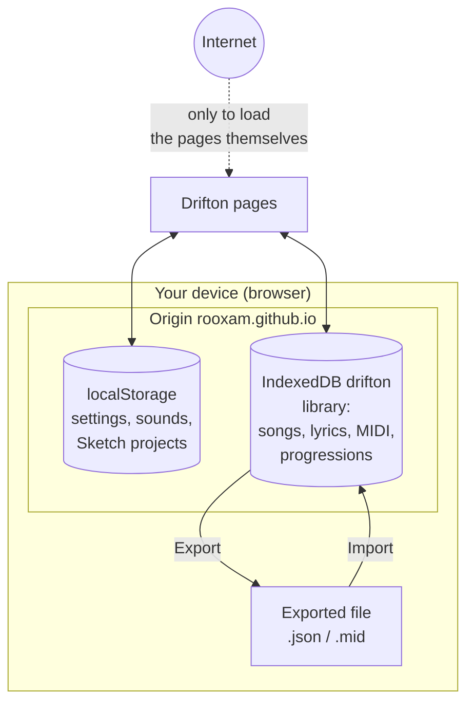

# 5. Data and privacy

*[Version française](../fr/5-donnees-et-vie-privee.md)*

What Drifton keeps, where, and what never leaves the device. This is also the basis of the
security review before the PWA.

## In one sentence

**Nothing leaves the device.** Drifton has no server, makes no network request once the
page is loaded (no `fetch`, no analytics, no third-party service, no font loaded from
elsewhere), and asks for no microphone, camera, location or MIDI access. The only external
links (example songs on Spotify, data sources) are plain links: nothing loads until you
click.

## Where the data lives

A browser gives each **origin** (scheme + domain + port) two storage spaces, invisible to
other sites:

- **localStorage**: a small key → text store (a few MB). For settings.
- **IndexedDB**: a real database in the browser, much bigger, which also keeps binary
  files. For the library.

### localStorage: the keys

| Key | Content | Written by |
|---|---|---|
| `drifton.focus.v1` | mood, key, volumes, session, open sections | Focus music |
| `drifton.focus.taste.v1` | what 👍 / 👎 have taught (μ, σ, number of votes per mood) | Focus music |
| `drifton.patches.v1` | sounds edited on the Synth page | Synth (read by all) |
| `drifton.sketch.v1` | Sketch projects (clips, notes) | Sketch |
| `drifton.sketch.prefs.v1` | Sketch's volume, reverb, echo | Sketch |
| `drifton.progressions.v1` | style, tonic, tempo, voicing… | Progressions |
| `drifton.progressions.favourites` | starred progressions | Progressions |
| `drifton.songbook.v1` | playback settings (sound, scroll speed…) | Songbook |
| `drifton.chords.v1` | chosen families, best score | Chords |
| `drifton.score.prefs` | metronome, zoom, views | Piano score |

### IndexedDB: the library (`library.js`)

One database `drifton`, one table `items`. Each item: `{ id, kind, name, updated, … }`.

| `kind` | Content | Page |
|---|---|---|
| `song` | a pasted song or an arrangement, **with its lyrics if any** | Songbook |
| `midi` | a MIDI file opened | Piano score |
| `progression` | a progression found in one of my MIDI files | Progressions |

This is the most personal data (lyrics, files): it stays here, is never sent, never put in
the repository. `library.js` asks the browser not to clear it on its own
(`navigator.storage.persist()`); Safari may still wipe the data of a site not visited for a
week, hence exporting, and the PWA (see below).

**Export / Import**: the whole library becomes a `.json` file (binary files written as
base64) to keep or move to another device. Import adds the items, or replaces those with the
same `id`.

## Security points to watch

- **The origin is shared by all my GitHub Pages sites.** Storage belongs to
  `rooxam.github.io`, not to `rooxam.github.io/drifton`. Another repository published on the
  same account could read this data. Today there is none; a domain of one's own (or a
  dedicated subdomain) would settle it.
- **`file://` and the live site share nothing**: they are two different origins. A library
  filled by double-clicking the HTML doesn't show up online, and vice versa (go through
  Export / Import).
- **Text coming from the user**: a pasted sheet, a project name, an imported file are shown
  in the page. Pages escape this text before inserting it as HTML (`esc` / `escapeHtml`
  functions), so a booby-trapped text can't run code. To check systematically on every new
  page: it's the main risk of a serverless site (an XSS attack in its own storage).
- **Imported files** (`.json`, `.mid`): read by our own code, never executed. A malformed
  MIDI file can at worst make reading fail.
- **Links between tools** (`?prog=`, `?chord=`): the page reads its address; a value it
  doesn't understand is ignored.

## Sensitive APIs

| API | Used? | What for |
|---|---|---|
| Network (`fetch`, `XMLHttpRequest`) | no | — |
| Microphone, camera (`getUserMedia`) | no | planned later (note detection, samples), to review first |
| Web MIDI | no | planned later (plugged-in keyboard) |
| Share (`navigator.share`) | yes, Sketch | send a `.mid` to AirDrop; you choose the destination |
| Screen awake (Wake Lock) | yes, Focus music | keep the screen on in full screen |
| Full screen | yes | visual, Songbook reading |
| Persistent storage | yes, `library.js` | ask not to clear the library |

## And the PWA?

A PWA (installable app) adds a *service worker*: a script that sits between the page and the
network to keep the site's files in a cache and work offline. It changes nothing about what
is stored above, but:

- on iPhone, an installed app escapes the one-week data wipe;
- a service worker controls every request in its scope: it must stay minimal, limited to the
  site's folder, and we must know how to update it (or we stay stuck on an old version).

That's the review to do together before adding it.
