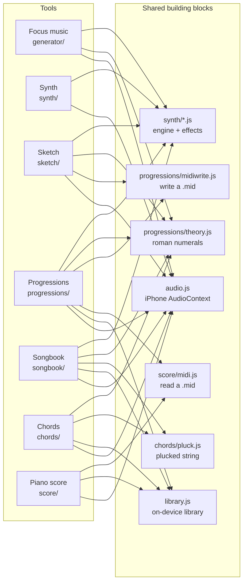
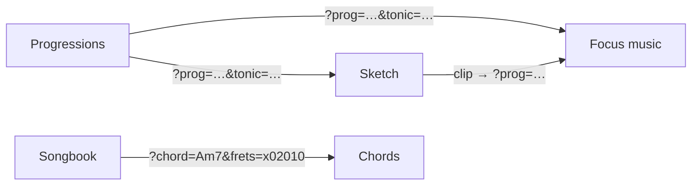

# Drifton — technical documentation

*[Version française](../fr/README.md)*

How Drifton works inside: the algorithms, the path of the sound, the data. The
[README](../../README.md) says what each tool does; [ROADMAP.md](../../ROADMAP.md) what is
planned. Here we explain **how**.

Diagrams are written in [Mermaid](https://mermaid.js.org/): GitHub draws them right in the
page. In VS Code, the "Markdown Preview Mermaid Support" extension shows them.

## Pages

| Doc | What it explains |
|---|---|
| [1. Sound and time](1-sound-and-time.md) | Web Audio, the synth (voices, oscillators, LFOs), the effects, the iPhone, how notes are played at the exact time |
| [2. Focus music](2-focus-music.md) | harmony (modes, Markov chain, voice leading), the five roles, the conductor, the session arc, the drift, learning your taste (👍 / 👎), the visual |
| [3. Chords and progressions](3-chords-and-progressions.md) | the Python analysis of 680,000 songs, roman numerals, voicings, key detection in a MIDI file, guitar positions, the arrangement format |
| [4. Sketch and MIDI](4-sketch-and-midi.md) | Sketch's data model, the transport, recording and Capture, the MIDI format (reading and writing), export to Ableton |
| [5. Data and privacy](5-data-and-privacy.md) | what is kept, where, and what never leaves the device; which sensitive APIs are used or not |

## Overview

Drifton is a **static** site: HTML, CSS and JavaScript files, no server, no dependencies.
Everything runs in the browser. Each tool is a folder with its own `index.html`, which
loads its scripts in order (classic `<script>` tags: it even works by double-clicking the
file, as `file://`).

Tools share **building blocks**: a tool loads another one's file with a plain
`<script src="../folder/file.js">`. Arrows read "uses".

Tools also talk through **links**: an address with parameters, such as
`generator/index.html?prog=I-V-vi-IV&tonic=0`. Nothing is sent anywhere: the next page
simply reads its own address.

## Small glossary

- **Web Audio**: the browser's API for making sound. You connect **nodes** (oscillator,
  filter, gain, delay…) like cables in a studio.
- **AudioContext**: the studio. It has its own clock (`ctx.currentTime`, in seconds), very
  precise, on which notes are scheduled.
- **AudioParam**: a setting of a node (frequency, volume…) that can move over time, or be
  driven by another signal (that's how LFOs work).
- **Pitch class**: a note without its octave, from 0 (C) to 11 (B).
- **MIDI note**: an exact pitch, 60 = middle C, +12 = one octave.
- **Bar, beat, 16th note**: 4 beats per bar (4/4), four 16th notes per beat.

## Keeping this documentation up to date

When an algorithm changes (generator rules, a data format, a storage key…), the page that
explains it changes in the same commit, in both languages. The comments at the top of each
`.js` file remain the most precise reference; this documentation gives the big picture and
the reasons.
