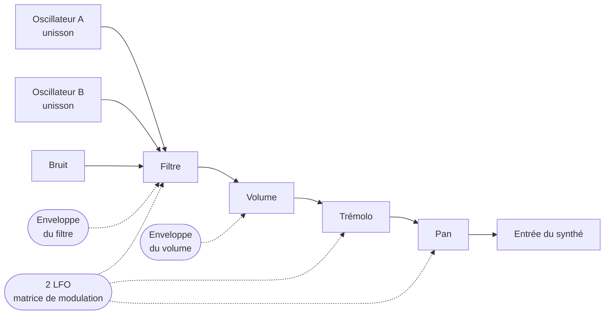
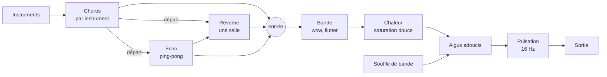
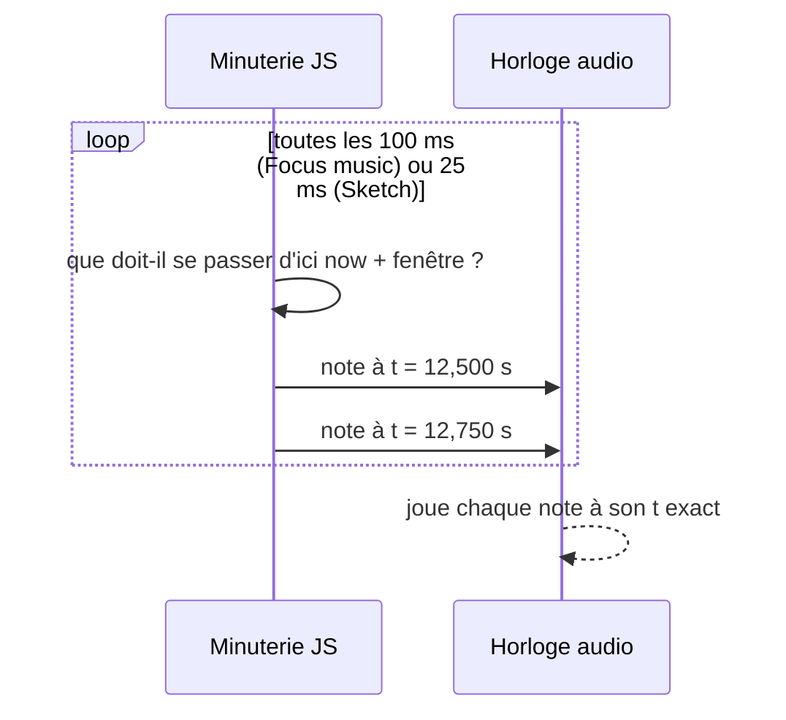

# 1. Le son et le temps

*[English version](../en/1-sound-and-time.md)*

Tout le son de Drifton est fabriqué en direct par le navigateur, avec **Web Audio** :
aucun fichier audio, aucun échantillon (sauf la réverbe, qu'on calcule aussi). Cette page
explique le chemin du son, du clavier jusqu'aux haut-parleurs, et comment on joue des
notes pile à l'heure.

## Le studio : un graphe de nœuds

En Web Audio, on relie des nœuds comme des câbles dans un studio. Un oscillateur produit
un signal, un filtre le colore, un gain règle son volume, et le dernier nœud est la
sortie (`ctx.destination`, les haut-parleurs).

Un nœud de Web Audio est **natif** : le navigateur le calcule en C++, dans un fil
d'exécution réservé au son. Le JavaScript ne calcule pas les échantillons ; il construit
le graphe et programme des changements. C'est pour ça qu'un synthé entier tient dans un
téléphone sans craquer.

## Une note du synthé (`synth/`)

Chaque note jouée crée une **voix** (`synth/voice.js`), jetée une fois la note éteinte.

- **Unisson** (`osc.js`) : chaque oscillateur est en fait plusieurs copies très légèrement
  désaccordées (quelques centièmes de demi-ton) et réparties en stéréo. Elles se
  décalent lentement les unes par rapport aux autres : c'est le son épais des nappes.
- **Enveloppe ADSR** (`envelope.js`) : Attack (montée), Decay (descente), Sustain (niveau
  tenu), Release (extinction après le relâchement). Elle ne fait pas de son : elle fait
  bouger un réglage dans le temps (le volume, ou l'ouverture du filtre).
- **LFO** (`lfo.js`) : un oscillateur trop lent pour être entendu (0,01 à 20 Hz), branché
  sur un réglage pour le faire bouger. Deux formes spéciales : *Drift* glisse vers une
  nouvelle valeur au hasard à chaque période (rien que l'oreille puisse anticiper), *S&H*
  y saute.
- **Matrice de modulation** (`params.js`) : quatre emplacements « telle source → tel
  réglage, de tant ».
- **Polyphonie** : 8 voix par synthé (14 pour le piano de Focus music). Au-delà, la plus
  ancienne est coupée en douceur (`steal`).

Un **son** (patch) n'est qu'un objet `{ réglage: valeur }` pour tous les réglages listés
dans `params.js` ; la page Synth génère son interface à partir de cette liste. Les sons de
départ sont dans `patches.js`, les sons modifiés sont gardés dans le navigateur
(`storage.js`, voir [page 5](5-donnees-et-vie-privee.md)).

## Les effets (`synth/effects.js`)

Les effets sont partagés par tous les instruments d'une page, comme une table de mixage
avec ses départs :

- **Réverbe** : un `ConvolverNode` fait passer le son par la « réponse » d'une salle. On
  n'enregistre pas de salle : on fabrique quelques secondes de bruit stéréo qui
  s'éteint en devenant plus sombre, ce que fait une vraie pièce.
- **Écho** : deux délais qui se renvoient le son (gauche, droite), avec un filtre dans la
  boucle qui rend chaque répétition plus douce, comme un écho à bande.
- **Chaleur** : une saturation douce (`tanh`, qui arrondit les crêtes et ajoute des
  harmoniques) puis un filtre qui adoucit les aigus.
- **Pulsation** : le volume monte et descend un peu, 4 à 16 fois par seconde (modulation
  d'amplitude). Brain.fm utilise 16 Hz pour la concentration.
- **Bande** : la hauteur ondule lentement (*wow*) et tremble vite (*flutter*) grâce à un
  délai très court dont la longueur bouge ; plus un souffle, coupé quand rien ne joue.
- **Chorus** : deux délais courts (13 et 17 ms) modulés en sens inverse, à gauche et à
  droite. Il vit *dans* l'instrument, et n'existe que si son réglage est au-dessus de 0
  (il ne coûte rien sinon).

Chaque son garde ses propres réglages d'effets : quantité de chorus, et combien il envoie
à la réverbe et à l'écho.

Après les effets, le **MasterBus** (`synth.js`) : un compresseur réglé très dur qui sert de
limiteur (il n'agit que sur les crêtes, pour ne jamais saturer), le volume général, et un
analyseur qui ne touche pas au son mais permet de le dessiner (oscilloscope, visuel).

## Jouer à l'heure exacte : le planificateur

Le piège : les minuteries JavaScript (`setTimeout`, `setInterval`) sont imprécises. Elles
peuvent arriver avec des dizaines de millisecondes de retard, beaucoup plus quand l'onglet
est en arrière-plan. Une batterie jouée comme ça sonnerait ivre.

L'horloge audio (`ctx.currentTime`), elle, est exacte. Et Web Audio accepte qu'on
programme une note **dans le futur** : `osc.start(t)` démarre pile à l'instant `t`.

D'où le **planificateur à anticipation** (*lookahead scheduler*) : une minuterie se
réveille souvent et programme tout ce qui doit sonner dans la fenêtre qui vient. Peu
importe qu'elle soit en retard de 20 ms : les notes, elles, sont déjà calées sur
l'horloge audio.

| Outil | Réveil | Fenêtre | Pourquoi |
|---|---|---|---|
| Focus music | 100 ms | 1,5 s | rien d'interactif à la note près : une grande marge résiste même à un onglet en arrière-plan |
| Sketch | 25 ms | 150 ms | un clip lancé, une note ajoutée ou un tempo changé doivent s'entendre presque tout de suite |

## Deux instruments sans oscillateur classique

- **Corde pincée** (`chords/pluck.js`, algorithme de Karplus-Strong, 1983) : une rafale de
  bruit placée dans une boucle exactement longue d'une période (fréquence
  d'échantillonnage ÷ fréquence de la note). La boucle se répète, donc on entend une
  hauteur ; à chaque passage on fait la moyenne de deux échantillons voisins, ce qui
  éteint les aigus plus vite que les graves, comme une vraie corde. Chaque note est
  calculée une fois (2,5 s) puis rejouée depuis un cache. Utilisée par Chords et par le
  son « Guitar » du Songbook.
- **Batterie de synthèse** (`sketch/drums.js`) : la grosse caisse est une sinusoïde dont la
  hauteur tombe très vite ; la caisse claire, un ton court plus une rafale de bruit ; le
  charley, six ondes carrées à des hauteurs sans rapport entre elles (le truc des boîtes
  à rythmes des années 80), filtrées dans l'aigu.

## L'iPhone (`audio.js`)

Chaque page crée son studio avec `createAudio()`, qui contourne deux pièges d'iOS :

1. **Le bouton silencieux** coupe le son web. Safari 17+ accepte qu'une page se déclare
   « lecteur » (`navigator.audioSession.type = "playback"`) ; pour les versions plus
   anciennes, on joue en boucle un petit fichier audio silencieux, ce qui fait passer la
   page en mode lecture.
2. **Le son ne démarre qu'après un geste**, et pour Safari un geste, c'est la *fin* d'un
   toucher (`touchend`, `click`), pas son début. On réveille donc le son sur ces
   événements, et à chaque retour sur l'onglet (après un appel, par exemple).
