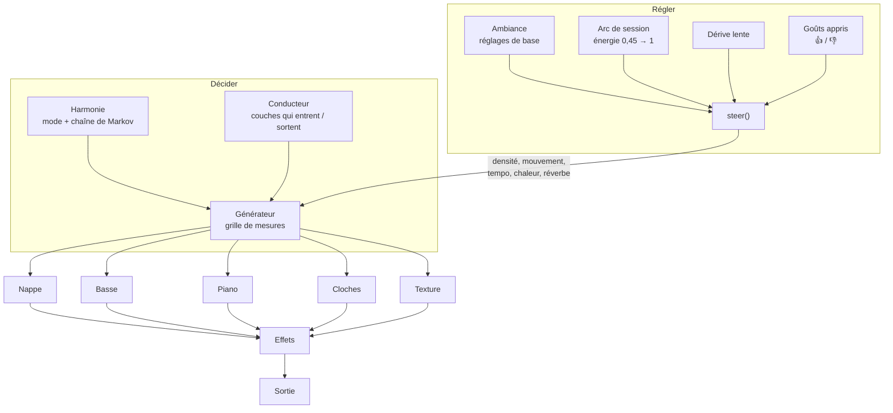
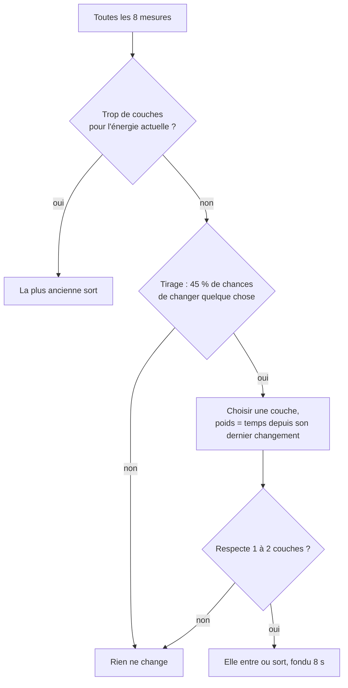
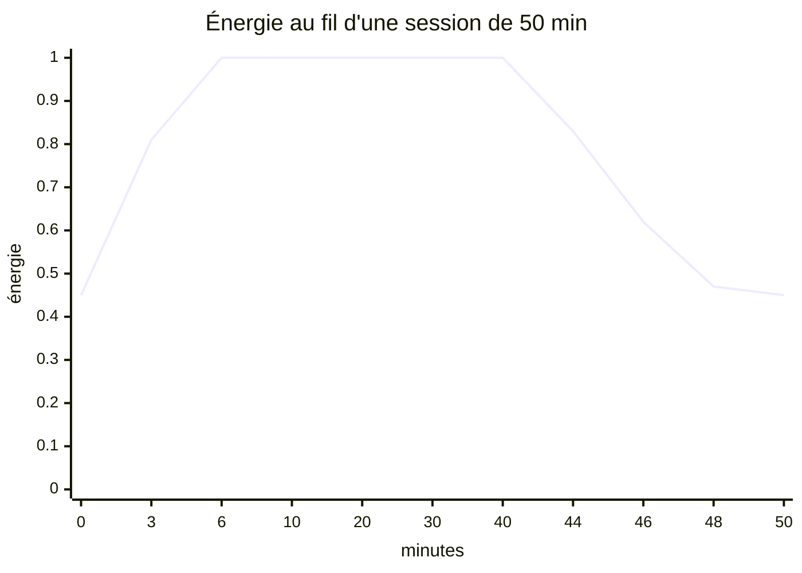
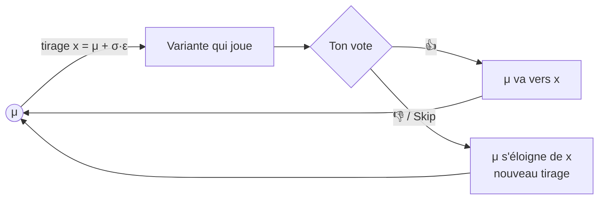

# 2. Focus music

*[English version](../en/2-focus-music.md)*

Focus music compose en direct, sans fin, une musique faite pour ne pas attirer
l'attention. Rien n'est enregistré : des **règles** décident à chaque mesure quelles notes
jouer. Cette page explique ces règles, de l'harmonie jusqu'à l'apprentissage de tes goûts.

Fichiers : `generator/harmony.js` (harmonie), `generator.js` (les rôles et le temps),
`moods.js` (ambiances), `session.js` (arc, dérive, filtres qui respirent), `taste.js`
(👍 / 👎), `visual.js` (visuel), `main.js` (la page, qui relie tout).

## Vue d'ensemble



Les curseurs de la page fixent une **base**. Ce qui joue réellement est cette base
déplacée un peu par l'arc de session, la dérive et tes goûts (fonction `steer()` de
`main.js`, appelée toutes les 2 secondes). Les curseurs ne bougent donc jamais tout seuls.

## L'harmonie (`harmony.js`)

### Un mode, et les accords qu'il contient

Un **mode** est une gamme de 7 notes. Ré dorien = ré mi fa sol la si do. On construit un
accord en empilant une note sur deux de la gamme (des « tierces ») : depuis ré, on obtient
ré fa la do mi = Rém7 avec une neuvième. Tous les accords construits ainsi appartiennent
au mode : **rien ne peut sonner faux**, ce qu'on veut pour une musique de fond.

| Mode | Couleur | Utilisé par |
|---|---|---|
| ionien (majeur) | lumineux | Calm |
| mixolydien | majeur chaleureux | Flow, Hazy |
| dorien | mineur doux, pas triste | Deep focus, Drone |
| éolien (mineur naturel) | mélancolique | Night, Sleep |

On écarte l'accord diminué (sans quinte juste) : trop tendu pour cette musique.

Trois **styles d'accords** : `sevenths` (accords de 4–5 notes, riches), `sus` (fondamentale,
quinte, seconde et sixte, sans tierce : ni gai ni triste, le son brumeux de Hazy), `drone`
(fondamentale et quinte, tenues très longtemps).

### Choisir l'accord suivant : une chaîne de Markov

L'accord suivant ne dépend que de l'accord actuel (c'est la définition d'une **chaîne de
Markov**). On tire au hasard parmi les autres degrés, avec un poids selon le saut de la
fondamentale :

| Saut (en degrés de la gamme) | Poids | Pourquoi |
|---|---|---|
| +3 (une quarte) | 3 | le mouvement le plus naturel de la musique tonale |
| +2, +4, +5 | 2 | sauts de tierce, doux, très courants en ambient |
| +1, +6 | 1 | mouvements par degré conjoint, plus rares |
| retour au degré I | +1,5 | revenir « à la maison » de temps en temps |

En style `drone`, on reste presque toujours sur le I, et on ne s'en écarte que vers le IV
ou le V, avant de revenir.

Un accord dure environ `chordSeconds` (12 à 60 s selon l'ambiance, ±25 % au hasard),
arrondi à 1, 2, 4 ou 8 mesures : les changements tombent toujours en début de mesure.

### Passer d'un accord à l'autre : le *voice leading*

Quand l'accord change, chaque note de la nappe va vers la note **la plus proche** du nouvel
accord ; une note commune aux deux accords ne bouge pas. Résultat : les changements
glissent au lieu de sauter. C'est ce que fait un pianiste qui enchaîne bien ses accords.

## Les cinq rôles (`generator.js`)

| Rôle | Ce qu'il joue |
|---|---|
| Nappe (pad) | 4 notes de l'accord, tenues, liées d'un accord à l'autre (voice leading) |
| Basse | la fondamentale, grave ; avec du mouvement : sur le 1ᵉʳ temps, parfois la quinte sur le « et » du 3 |
| Piano (keys) | de petits arpèges sur l'accord, en croches ; plus chargés quand le mouvement monte, certaines mesures vides. En Hazy : un **riff** de 5 à 7 notes répété mesure après mesure, recalé sur chaque accord, nouveau toutes les 16 mesures |
| Cloches | des notes isolées (voir plus bas) |
| Texture | une note longue, qui change rarement |

### Les cloches : une marche aléatoire

- **Quand** : l'écart entre deux cloches suit une **loi exponentielle** (comme des gouttes
  de pluie : pas de pulsation). Le nombre moyen de cloches par seconde vaut
  `0,03 + 0,5 × densité`.
- **Quelle note** : une marche aléatoire sur la gamme, par petits pas (±1 ou ±2 degrés le
  plus souvent), qui rebondit sur les bords. Une note hors de l'accord est souvent
  poussée sur sa voisine (6 fois sur 10) : la mélodie s'appuie sur l'accord.
- **Un motif** : 15 % du temps, les 3–4 dernières notes sont rejouées. L'oreille croit
  reconnaître quelque chose, sans jamais entendre un vrai air.

## Le conducteur : des couches qui vont et viennent

Le piano, les cloches et la texture sont des couches **optionnelles**. Toutes les 8
mesures, le conducteur peut en faire entrer ou sortir une, en fondu sur 8 secondes.



- **Le poids** donné à chaque couche est le temps depuis son dernier changement : celle qui
  n'a pas bougé depuis longtemps a le plus de chances de changer. Chaque couche a son tour.
- **Jamais vide, jamais chargé** : toujours au moins une couche optionnelle, au plus deux
  (une seule à faible énergie, ou en Sleep).
- **Une couche coupée** à la main sur la page ne compte pas comme « en train de jouer ».
- **Au démarrage** : nappe et basse seules pendant 2 mesures (le temps que la réverbe se
  remplisse), puis les couches entrent en fondu.

## L'arc de session (`session.js`)

Une session de 15 à 90 minutes a une forme : départ doux, plateau, descente, fondu final.
Elle se résume à un seul nombre, l'**énergie**, entre 0,45 et 1.



(Sur les 75 dernières secondes, c'est le volume qui descend à zéro ; l'énergie reste à 0,45.)

- **Montée** : 12 % de la session, entre 2 et 5 minutes. Aussi en mode continu.
- **Descente** : 15 % de la session, entre 3 et 8 minutes, juste avant le fondu.
- **Fondu final** : 75 s (2 min en Sleep), puis arrêt propre.
- En **Sleep**, la forme est « down » : ça descend doucement de la première à la dernière
  minute.
- Les transitions utilisent une courbe en S (`x² (3 − 2x)`) : pas de coude audible.

Ce que fait une énergie basse : moins de cloches (densité × `0,35 + 0,65 e`), moins de
rythme (mouvement × `0,5 + 0,5 e`), un son plus chaud et plus sombre, une seule couche
optionnelle.

## La dérive lente

En continu, densité, mouvement et luminosité errent très lentement autour des réglages,
pour qu'une heure de musique ne soit jamais tout à fait immobile. Chaque réglage suit un
**processus d'Ornstein–Uhlenbeck** (une marche aléatoire qui revient vers sa moyenne) :

```
x ← x − x·dt/τ + taille·√(2·dt/τ)·N(0, 1)
```

- `τ = 4 min` : la force de rappel met des minutes à ramener le réglage.
- `taille` est l'écart typique une fois stabilisé : ±6 % de densité, ±4 % de mouvement,
  ±0,05 de luminosité. Plafonné à 2,5 tailles.
- `N(0, 1)` est tiré par la méthode de Box–Muller (deux nombres uniformes → un nombre de
  loi normale).

C'est volontairement petit : on ne doit pas le remarquer, seulement le sentir.

## Les filtres qui respirent

La nappe et la texture passent par un filtre passe-bas doux dont la fréquence de coupure
est poussée par **deux sinusoïdes très lentes**, de 48 s et 29 s, jusqu'à environ ¾
d'octave. Leurs périodes ne se divisent pas : la respiration ne retombe jamais exactement
sur la même boucle. L'arc de session assombrit ce filtre au début et à la fin.

## Apprendre tes goûts : 👍 / 👎 / Skip (`taste.js`)

Un petit **bandit** par ambiance apprend 5 décalages, chacun entre −1 et +1, ajoutés aux
réglages de l'ambiance :

| Réglage | À ±1 |
|---|---|
| densité | ±15 % de cloches |
| mouvement | ±20 % de rythme |
| luminosité | plus clair / plus sombre |
| tempo | ±8 bpm |
| réverbe | ±15 % de salle |

### La politique

Pour chaque ambiance, on garde une moyenne **μ** (notre meilleure idée de ce que tu aimes,
0 au départ = l'ambiance telle que conçue) et une largeur **σ** (notre incertitude, 0,35
au départ). Ce qui joue est une **variante** tirée autour de μ : `x = μ + σ·ε`, avec
`ε ~ N(0, 1)` sur chaque réglage. Une nouvelle variante à chaque visite.

### La mise à jour

```
μ ← μ + 0,5 · récompense · (x − μ)          σ ← max(0,12 ; 0,9 · σ)
```

| Bouton | Récompense | Effet sur μ | Ensuite |
|---|---|---|---|
| 👍 Like | +1 | fait la moitié du chemin vers la variante | la variante reste |
| 👎 Dislike | −1 | s'éloigne d'une demi-distance | nouvelle variante tout de suite |
| Skip | −0,4 | s'éloigne d'un cinquième | nouvelle variante, accord suivant à la prochaine mesure |



C'est le pas de **REINFORCE** (gradient de politique) pour une politique gaussienne : le
gradient de `log N(x ; μ, σ)` par rapport à μ vaut `(x − μ) / σ²`. Les stratégies
d'évolution font la même chose. σ diminue à chaque vote : plus tu as voté, moins on
explore loin.

Exemple, Calm, sur le tempo : μ = 0, la variante tirée vaut −0,5 (= −4 bpm). Tu likes :
μ passe à −0,25 (−2 bpm), et les variantes suivantes tournent autour de −2 bpm.

**Limites** : le vote juge tout ce qui joue (un accord, une cloche mal placée…), pas
seulement ces 5 réglages, donc l'apprentissage ne vaut qu'en moyenne sur plusieurs votes ;
un 👎 pousse les 5 réglages à la fois ; timbres et harmonie ne sont pas appris.

Tout reste dans le navigateur (clé `drifton.focus.taste.v1`), effaçable par « Forget my
tastes ».

## Les ambiances (`moods.js`)

Une ambiance n'est qu'un jeu de réglages : mode, tempo, durée des accords, densité,
mouvement, réverbe, écho, chaleur, pulsation, bande, style d'accords. **Auto** choisit selon
l'heure : Flow le matin, Deep focus l'après-midi, Calm le soir, Night la nuit, Sleep
seulement entre 1 h et 5 h (sans minuterie : la musique ne s'arrête pas toute seule).

## Jouer une progression

Avec `?prog=I-V-vi-IV&tonic=0` dans l'adresse, le générateur remplace sa chaîne de Markov
par cette boucle d'accords, à durée fixe. Les chiffres romains sont lus par
`progressions/theory.js` (voir [page 3](3-accords-et-progressions.md)). Une cloche qui
tombe un demi-ton à côté d'une note de l'accord (accord emprunté, comme bVII) glisse sur
elle.

## Le visuel (`visual.js`)

Un faux 3D en Canvas 2D : chaque objet a une position (x, y, z), et on divise par z pour
dessiner (plus c'est loin, plus c'est petit et proche du centre). La caméra avance
lentement.

- **Chaque instrument a ses formes** : nappe = cercles et planètes, basse = faisceaux de
  traits, texture = volumes en fil de fer qui tournent, cloches et piano = lueurs.
- **Une lueur est placée à l'angle de sa note** : do en haut, puis dans le sens des
  aiguilles d'une montre, comme un cadran de 12 notes.
- **Traînées** : chaque image repart de la précédente, un peu agrandie, tournée et
  estompée (*feedback*).
- **Réagir au son** : l'analyseur donne l'énergie des graves, des médiums et des aigus,
  comparée à leur crête récente (pour réagir pareil à un son fort ou faible).
- **Rien ne clignote** : la pulsation à 16 Hz n'est volontairement pas montrée (un
  scintillement rapide fatigue, voire peut être dangereux). Le visuel ne dessine que s'il
  est visible.
