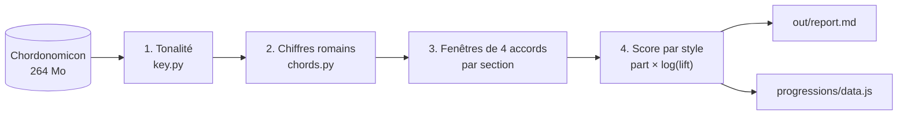
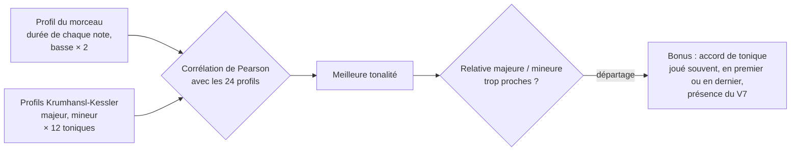

# 3. Accords et progressions

*[English version](../en/3-chords-and-progressions.md)*

Cette page couvre tout ce qui parle d'accords : l'analyse hors ligne de 680 000 morceaux
(Python), les chiffres romains, les voicings, la détection de tonalité d'un fichier MIDI,
les positions de guitare et le format des arrangements.

## Les chiffres romains, la langue commune

Un accord écrit en chiffre romain est relatif à la tonique : `I` est l'accord bâti sur la
tonique, `V` sur la quinte, etc. La même progression `I–V–vi–IV` donne do–sol–lam–fa en
do, ou ré–la–sim–sol en ré. C'est ce qui permet de **comparer des morceaux** dans des
tonalités différentes, et de **transposer** d'un geste.

Drifton écrit les chiffres de façon chromatique, comme le jeu de données :

| Écriture | Sens |
|---|---|
| `vi` | minuscule = accord mineur |
| `bVII` | `b` = un demi-ton plus bas que le degré de la gamme majeure (ici un ton sous la tonique) |
| `IVmaj7`, `V7`, `ii7` | la couleur (qualité) suit le chiffre |
| `IV/5` | l'accord IV avec la 5ᵉ de la tonalité à la basse |

`progressions/theory.js` lit ces chiffres (`parseNumeral`, une expression régulière),
les transforme en accord dans une tonalité (`makeChord`) puis en notes (`voiceChord`).
Focus music, Sketch, Progressions, le Songbook et Chords passent tous par lui.

## L'analyse de Chordonomicon (`tools/progressions/`, Python)

Le jeu de données [Chordonomicon](https://huggingface.co/datasets/ailsntua/Chordonomicon)
donne les accords de ~680 000 morceaux, sans leur tonalité. Le script Python (bibliothèque
standard seulement) en tire des progressions **typiques d'un style mais rares ailleurs**.



1. **Tonalité** : on compte les notes entendues dans les accords et on compare avec le
   profil typique des 24 tonalités (voir Krumhansl plus bas), plus un bonus pour l'accord
   qui ouvre les sections et termine le morceau.
2. **Chiffres romains** : chaque accord devient un degré au-dessus de la tonique. Deux
   niveaux : le squelette (`vi`), qu'on compte, et la couleur (`vi7`), qu'on garde pour
   montrer comment le style habille la progression.
3. **Fenêtres** : dans chaque section, les accords répétés sont fusionnés, puis une fenêtre
   de 4 accords glisse. Une fenêtre peut cacher une boucle plus courte (`i bVII i bVII` →
   `i bVII`), et toutes les rotations d'une boucle comptent pour une (`I V vi IV` =
   `vi IV I V`).
4. **Score** : pour chaque style, `part des morceaux du style qui l'utilisent × log(lift)`,
   où le **lift** dit combien de fois la boucle est plus fréquente dans ce style que dans
   tous les morceaux. C'est l'idée de TF-IDF pour les mots d'un document : ce qui est
   fréquent ici *et* rare ailleurs.

Licence CC BY-NC 4.0 : utilisable avec attribution, **pas d'usage commercial**.

## Les voicings (`progressions/voicing.js`)

Un voicing dit quelles notes de l'accord la main droite joue, et où.

| Style | Ce que c'est |
|---|---|
| close (serré) | toutes les notes groupées, chaque accord au plus près du précédent. Par défaut |
| open (ouvert) | le même, une note sur deux montée d'une octave : large, aéré |
| drop 2 | le serré, avec sa 2ᵉ note depuis le haut descendue d'une octave : l'écartement classique du jazz |
| shell | sans fondamentale (la basse la joue) : tierce et septième, les notes qui disent ce qu'est l'accord, plus les tensions |

Tous partent d'un voicing serré bien placé, pour que l'enchaînement reste fluide quel que
soit le style.

## Trouver la tonalité et les accords d'un MIDI (`progressions/analyze.js`)

« Analyse my MIDI file » transforme un fichier MIDI en progression, en trois étapes.

**1. Les accords.** On découpe le morceau par mesure (ou par temps), on pèse les notes qui
sonnent dans chaque tranche, et on essaie tous les accords (12 fondamentales × 11
qualités). Les notes de l'accord comptent pour lui, les autres contre lui, un accord plus
riche doit mériter sa note en plus, une fondamentale à la basse a un bonus.

**2. La tonalité : l'algorithme de Krumhansl-Schmuckler.** Dans des expériences d'écoute,
Krumhansl et Kessler ont fait noter à des auditeurs à quel point chaque note « va bien »
après une tonalité donnée. Ça donne un profil de 12 valeurs pour le majeur et un pour le
mineur.



Do majeur et la mineur partagent leurs notes et obtiennent presque le même score : ce sont
les accords qui départagent. Quand les accords eux-mêmes sont identiques, l'ambiguïté reste,
et la page l'affiche (« or maybe A minor »).

**3. La boucle.** La plupart des morceaux répètent quelques accords : on cherche le groupe
de 2 à 8 accords qui couvre le plus de morceau.

## La vue Push (`progressions/push.js`)

La grille 8×8 du Push d'Ableton, dans ses deux dispositions :

- **chromatique** : un pad vers la droite = un demi-ton, une rangée vers le haut = une
  quarte. Un type d'accord a toujours la même forme, quelle que soit la tonalité.
- **In Key** : seulement les notes de la gamme. Un pad vers la droite = la note suivante de
  la gamme, une rangée vers le haut = trois notes de gamme plus haut (une quarte encore).
  Pas de fausse note, mais un accord emprunté hors de la gamme ne peut pas se jouer entier.

## La guitare : des positions calculées (`chords/positions.js`)

Pour n'importe quel accord, Chords cherche des positions jouables le long du manche :

- d'abord la position **écrite à la main** (`chords/shapes.js`) s'il y en a une, ou celle
  passée par le lien du Songbook ;
- puis, pour chaque position de la main, la meilleure forme sur **4 cases** (toujours
  jouable), au plus 4 doigts, au moins 3 cordes, avec toutes les notes de l'accord sauf
  éventuellement la quinte, et la note de basse la plus grave.

Les noms de notes sont orthographiés pour l'accord : mi majeur a un sol#, pas un lab.

## Le format des arrangements (`songbook/arrange.js`)

Une fiche d'un site d'accords n'a pas de rythme : chaque accord y dure pareil. Un
arrangement, si : c'est ma façon de jouer le morceau.

```
Hurt — Johnny Cash                                  ← titre — artiste
Tempo 92 · Capo 0 · Time 4/4 · Strum: D  D U  U D U  ← réglages, dans n'importe quel ordre
Shapes: Am=x02210  C=x32010  Dsus2=xx0230  G=320003  ← mes positions
[Verse]                                             ← une partie
| Am . C . | Dsus2 . . . | Am . C . | Dsus2 . . . |  ← mesures : un mot par temps
```

- Dans une mesure, **chaque mot est un temps** : un accord commence là, `.` tient l'accord
  d'avant. Une mesure avec un seul accord dure toute la mesure.
- `%` répète la mesure d'avant, `N.C.` est un silence, `x2` en fin de ligne la répète.
- **Grattage** : un coup par case, les cases réparties sur la mesure (8 en 4/4 = des
  croches). `D` = vers le bas, `U` = vers le haut, `x` = coup étouffé, minuscule = plus
  doux.

À la lecture (`songbook/strum.js`), chaque accord est gratté en suivant le motif : vers le
bas, de la corde grave à l'aiguë ; vers le haut, l'inverse ; 14 ms entre deux cordes ;
accent sur les temps.

## Une fiche collée depuis un site (`songbook/sheet.js`)

Deux écritures reconnues : une ligne d'accords **au-dessus** de la ligne de paroles (on
garde la colonne de chaque accord pour le replacer sur la bonne syllabe), ou les accords
**dans** les paroles (`[Am]des [C]mots`, le style ChordPro). Une ligne dont tous les mots
sont des accords est une ligne d'accords. Les paroles restent sur l'appareil, jamais dans
le dépôt.
