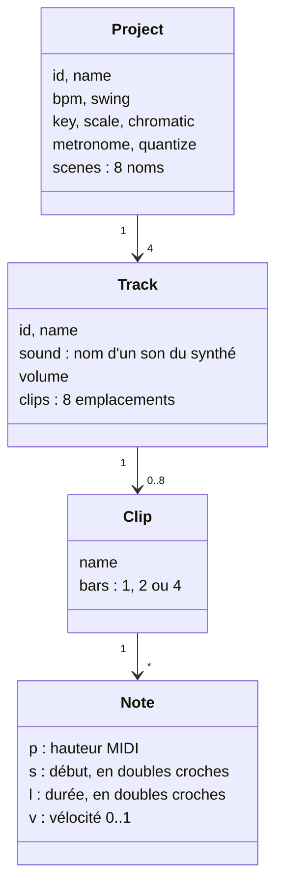
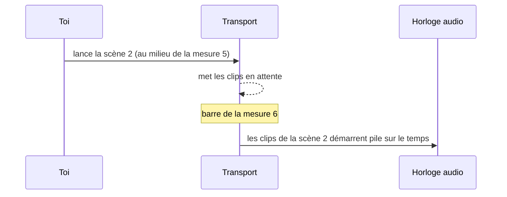
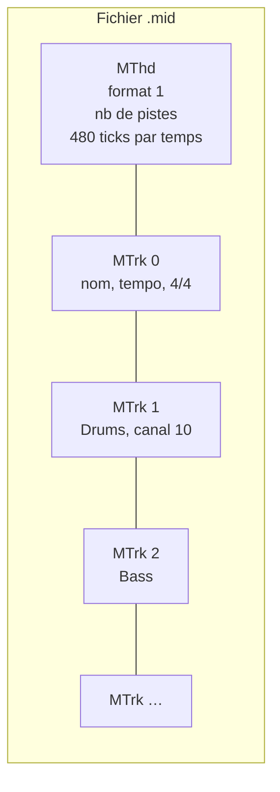
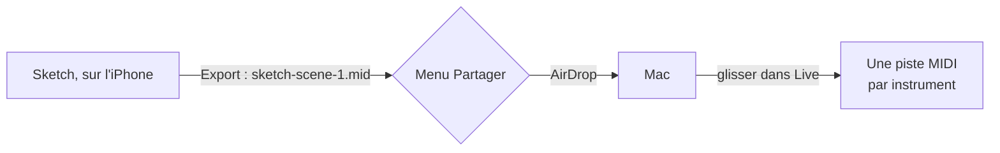

# 4. Sketch et le MIDI

*[English version](../en/4-sketch-and-midi.md)*

Sketch sert à noter une idée sur le téléphone et à l'envoyer dans Ableton Live. Cette page
explique son modèle de données, son horloge, l'enregistrement et Capture, puis le format
MIDI, que Drifton sait lire (Piano score, l'analyse de Progressions) et écrire (Sketch,
Progressions).

## Le modèle de données (`sketch/song.js`)

Un projet est un simple objet JSON : il se garde tel quel dans le navigateur et s'exporte
tel quel en fichier.

- Quatre pistes, toujours les mêmes : batterie, basse, Keys, nappe.
- Une **scène** est une rangée d'emplacements, lancée d'un coup.
- Pour la batterie, `p` est la note General MIDI du son : 36 grosse caisse, 37 rimshot,
  38 caisse claire, 39 clap, 42 charley fermé, 46 charley ouvert. C'est ce qu'attendent les
  Drum Racks d'Ableton.
- Les débuts sont des nombres entiers une fois quantifiés, des fractions quand on enregistre
  sans quantification.

## L'horloge (`sketch/transport.js`)

Le transport compte des **doubles croches** et programme leurs notes avec le planificateur à
anticipation décrit [page 1](1-son-et-temps.md) (réveil toutes les 25 ms, fenêtre de
150 ms).

- **Swing** : une double croche sur deux arrive un peu en retard. À 100 %, elle tombe aux ⅔
  de la croche, comme un rythme ternaire.
- **Lancement quantifié** : un clip demandé attend la prochaine barre de mesure, puis part de
  son début. Une piste joue un seul clip ; en demander un autre le remplace à la mesure
  suivante.
- **Changer de tempo** en jouant garde la position et recale la suite.

## Jouer, enregistrer, capturer (`sketch/pads.js`)

- **Pads mélodiques** : une grille 5×5 des seules notes de la gamme (rien ne peut sonner
  faux), chaque rangée une quarte au-dessus de la précédente, la tonique allumée. Taper plus
  haut sur un pad joue plus fort.
- **Enregistrer** : pendant que le transport tourne, ce que tu joues entre dans le clip de la
  piste, **à la position que tu entendais**. On retire la latence de sortie de l'appareil :
  sur un téléphone, le son sort quelques dizaines de millisecondes après avoir été
  programmé, et tu joues sur ce que tu entends. Une note tapée un poil avant le début de la
  boucle compte pour son début. Quantifiée à la double croche si l'option est cochée.
- **Capture** : les dernières notes jouées (sans enregistrer) sont toujours gardées. Capture
  remonte depuis la dernière note jusqu'à un silence de plus de 2 mesures : c'est la
  phrase. Elle devient un clip de 1, 2 ou 4 mesures (au plus les 4 dernières), calé sur la
  grille si le transport tournait, sinon à partir de la première note.

## Le format MIDI

Un fichier MIDI (`.mid`) ne contient pas de son : seulement des **événements** (note
enfoncée, note relâchée, tempo…). C'est pour ça qu'il est si léger, et qu'Ableton peut
jouer les notes avec n'importe quel instrument.

- **L'en-tête** (`MThd`) dit le format (1 = plusieurs pistes jouées ensemble), le nombre de
  pistes et combien de **ticks** font un temps (480 chez nous).
- **Chaque piste** (`MTrk`) est une liste d'événements, chacun précédé du temps écoulé depuis
  le précédent, en ticks, écrit en « longueur variable » (7 bits par octet, le 8ᵉ dit
  « il en reste »).
- **Une note** = un événement « note on » (canal, hauteur, vélocité) puis un « note off ».
- **Le tempo** est un méta-événement : la durée d'un temps en microsecondes. C'est lui qui
  transforme des ticks en secondes.

**Lire** (`score/midi.js`) : on parcourt les octets, on suit les changements de tempo pour
convertir les ticks en secondes, on apparie chaque « note on » avec son « note off ». Le
résultat : des notes avec leur temps en secondes, groupées par piste, plus les barres de
mesure et la liste des temps.

**Écrire** (`progressions/midiwrite.js`, réutilisé par `sketch/midiexport.js`) : l'inverse.
Une piste de tempo, puis une piste par instrument, nommée ; la batterie sur le canal 10
(General MIDI). Le swing n'est pas écrit : Live peut appliquer son propre groove.

## Vers Ableton Live

Sur un appareil tactile, l'export ouvre le menu Partager quand le navigateur sait partager
un fichier (`navigator.canShare({ files })`) ; sinon le fichier se télécharge. Glissé dans
Live, un `.mid` d'une scène donne une piste par instrument ; les sons, eux, se choisissent
dans Live.
