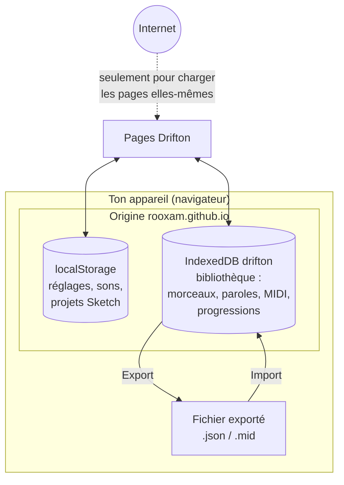

# 5. Données et vie privée

*[English version](../en/5-data-and-privacy.md)*

Ce que Drifton garde, où, et ce qui ne quitte jamais l'appareil. C'est aussi la base de la
revue de sécurité avant la PWA.

## En une phrase

**Rien ne quitte l'appareil.** Drifton n'a pas de serveur, ne fait aucune requête réseau
une fois la page chargée (pas de `fetch`, pas de statistiques, pas de service tiers, pas de
police chargée ailleurs), et ne demande ni micro, ni caméra, ni position, ni accès MIDI.
Les seuls liens externes (morceaux d'exemple sur Spotify, sources des données) sont de
simples liens : rien ne se charge tant que tu ne cliques pas.

## Où sont les données

Un navigateur donne à chaque **origine** (protocole + domaine + port) deux espaces de
stockage, invisibles des autres sites :

- **localStorage** : un petit magasin clé → texte (quelques Mo). Pour les réglages.
- **IndexedDB** : une vraie base de données dans le navigateur, bien plus grande, qui garde
  aussi des fichiers binaires. Pour la bibliothèque.

### localStorage : les clés

| Clé | Contenu | Écrit par |
|---|---|---|
| `drifton.focus.v1` | ambiance, tonalité, volumes, session, sections ouvertes | Focus music |
| `drifton.focus.taste.v1` | ce que 👍 / 👎 ont appris (μ, σ, nombre de votes par ambiance) | Focus music |
| `drifton.patches.v1` | les sons modifiés sur la page Synth | Synth (lu par tous) |
| `drifton.sketch.v1` | les projets Sketch (clips, notes) | Sketch |
| `drifton.sketch.prefs.v1` | volume, réverbe, écho de Sketch | Sketch |
| `drifton.progressions.v1` | style, tonique, tempo, voicing… | Progressions |
| `drifton.progressions.favourites` | progressions étoilées | Progressions |
| `drifton.songbook.v1` | réglages de lecture (son, vitesse de défilement…) | Songbook |
| `drifton.chords.v1` | familles choisies, record | Chords |
| `drifton.score.prefs` | métronome, zoom, vues | Piano score |

### IndexedDB : la bibliothèque (`library.js`)

Une base `drifton`, une table `items`. Chaque élément : `{ id, kind, name, updated, … }`.

| `kind` | Contenu | Page |
|---|---|---|
| `song` | un morceau collé ou un arrangement, **avec ses paroles éventuelles** | Songbook |
| `midi` | un fichier MIDI ouvert | Piano score |
| `progression` | une progression trouvée dans un de mes MIDI | Progressions |

C'est la donnée la plus personnelle (paroles, fichiers) : elle reste ici, n'est jamais
envoyée, jamais mise dans le dépôt. `library.js` demande au navigateur de ne pas l'effacer
de lui-même (`navigator.storage.persist()`) ; Safari peut quand même vider les données d'un
site non visité depuis une semaine, d'où l'intérêt d'exporter, et de la PWA (voir plus bas).

**Export / Import** : toute la bibliothèque devient un fichier `.json` (les fichiers
binaires écrits en base64) qu'on garde ou qu'on passe à un autre appareil. L'import ajoute
les éléments, ou remplace ceux de même `id`.

## Points d'attention pour la sécurité

- **L'origine est partagée par tous mes sites GitHub Pages.** Le stockage appartient à
  `rooxam.github.io`, pas à `rooxam.github.io/drifton`. Un autre dépôt publié sur le même
  compte pourrait lire ces données. Aujourd'hui il n'y en a pas d'autre ; un domaine à
  soi (ou un sous-domaine dédié) réglerait la question.
- **`file://` et le site en ligne ne partagent rien** : ce sont deux origines différentes.
  Une bibliothèque remplie en double-cliquant le HTML n'apparaît pas en ligne, et
  inversement (passer par Export / Import).
- **Texte venu de l'utilisateur** : une fiche collée, un nom de projet, un fichier importé
  sont affichés dans la page. Les pages échappent ce texte avant de l'insérer en HTML
  (fonctions `esc` / `escapeHtml`), pour qu'un texte piégé ne puisse pas exécuter de
  code. À vérifier systématiquement à chaque nouvelle page : c'est le principal risque
  d'un site sans serveur (une attaque XSS dans son propre stockage).
- **Fichiers importés** (`.json`, `.mid`) : lus par du code à nous, jamais exécutés. Un
  fichier MIDI malformé peut au pire faire échouer la lecture.
- **Liens entre outils** (`?prog=`, `?chord=`) : la page lit son adresse ; une valeur
  qu'elle ne comprend pas est ignorée.

## Les API sensibles

| API | Utilisée ? | Pour quoi |
|---|---|---|
| Réseau (`fetch`, `XMLHttpRequest`) | non | — |
| Micro, caméra (`getUserMedia`) | non | prévu plus tard (détection des notes, samples), à revoir avant |
| Web MIDI | non | prévu plus tard (clavier branché) |
| Partage (`navigator.share`) | oui, Sketch | envoyer un `.mid` vers AirDrop ; c'est toi qui choisis la destination |
| Écran allumé (Wake Lock) | oui, Focus music | garder l'écran allumé en plein écran |
| Plein écran | oui | visuel, lecture du Songbook |
| Stockage persistant | oui, `library.js` | demander de ne pas effacer la bibliothèque |

## Et la PWA ?

Une PWA (application installable) ajoute un *service worker* : un script qui s'interpose
entre la page et le réseau pour garder les fichiers du site en cache et marcher hors
ligne. Il ne change rien à ce qui est stocké ci-dessus, mais :

- sur iPhone, une app installée échappe à l'effacement des données après une semaine ;
- un service worker contrôle toutes les requêtes de son périmètre : il faut le garder
  minimal, limité au dossier du site, et savoir le mettre à jour (sinon on reste coincé
  sur une ancienne version).

C'est le sujet de la revue à faire ensemble avant de l'ajouter.
