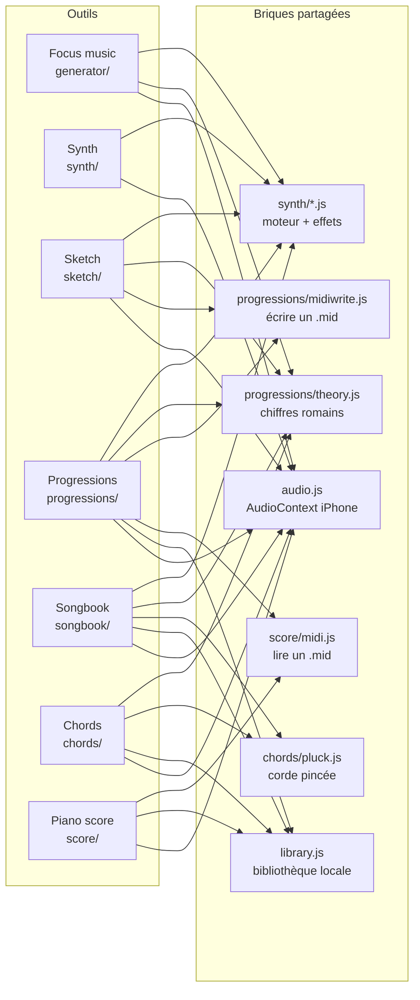
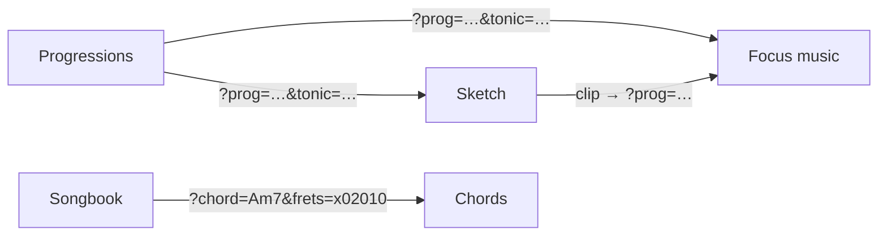

# Drifton — documentation technique

*[English version](../en/README.md)*

Comment Drifton marche à l'intérieur : les algorithmes, le chemin du son, les données.
Le [README](../../README.md) dit ce que fait chaque outil ; [ROADMAP.md](../../ROADMAP.md) ce qui
est prévu. Ici, on explique **comment**.

Les schémas sont en [Mermaid](https://mermaid.js.org/) : GitHub les dessine directement
dans la page. Dans VS Code, l'extension « Markdown Preview Mermaid Support » les affiche.

## Les pages

| Doc | Ce qu'elle explique |
|---|---|
| [1. Le son et le temps](1-son-et-temps.md) | Web Audio, le synthé (voix, oscillateurs, LFO), les effets, l'iPhone, comment on joue des notes à l'heure exacte |
| [2. Focus music](2-focus-music.md) | l'harmonie (modes, chaîne de Markov, voice leading), les cinq rôles, le conducteur, l'arc de session, la dérive, l'apprentissage des goûts (👍 / 👎), le visuel |
| [3. Accords et progressions](3-accords-et-progressions.md) | l'analyse Python des 680 000 morceaux, les chiffres romains, les voicings, la détection de tonalité d'un MIDI, les positions de guitare, le format des arrangements |
| [4. Sketch et le MIDI](4-sketch-et-midi.md) | le modèle de données de Sketch, le transport, l'enregistrement et Capture, le format MIDI (lecture et écriture), l'export vers Ableton |
| [5. Données et vie privée](5-donnees-et-vie-privee.md) | ce qui est gardé, où, et ce qui ne quitte jamais l'appareil ; les API sensibles utilisées ou non |

## Vue d'ensemble

Drifton est un site **statique** : des fichiers HTML, CSS et JavaScript, sans serveur, sans
dépendance. Tout s'exécute dans le navigateur. Chaque outil est un dossier avec son
`index.html`, qui charge ses scripts dans l'ordre (des `<script>` classiques : ça marche
même en double-cliquant le fichier, en `file://`).

Les outils partagent des **briques** : un outil en charge d'autres avec un simple
`<script src="../dossier/fichier.js">`. Les flèches se lisent « utilise ».

Les outils se parlent aussi par **liens** : une adresse avec des paramètres, comme
`generator/index.html?prog=I-V-vi-IV&tonic=0`. Rien n'est envoyé nulle part : la page
suivante lit simplement son adresse.

## Petit glossaire

- **Web Audio** : l'API du navigateur pour fabriquer du son. On assemble des **nœuds**
  (oscillateur, filtre, gain, délai…) reliés comme des câbles dans un studio.
- **AudioContext** : le studio. Il a sa propre horloge (`ctx.currentTime`, en secondes),
  très précise, sur laquelle on programme les notes.
- **AudioParam** : un réglage d'un nœud (fréquence, volume…) qu'on peut faire évoluer
  dans le temps, ou brancher sur un autre signal (c'est comme ça que marchent les LFO).
- **Pitch class** (classe de hauteur) : une note sans son octave, de 0 (do) à 11 (si).
- **Note MIDI** : une hauteur précise, 60 = do du milieu, +12 = une octave.
- **Mesure, temps, double croche** : 4 temps par mesure (4/4), 4 doubles croches par temps.

## Tenir cette doc à jour

Quand un algorithme change (règles du générateur, format de données, clé de stockage…),
la page qui l'explique change dans le même commit, en français et en anglais. Les commentaires en tête de chaque
fichier `.js` restent la référence la plus précise ; cette doc donne la vue d'ensemble et
les raisons.
